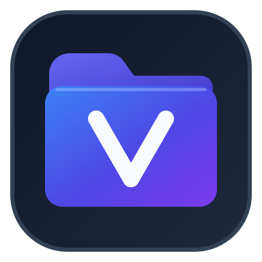
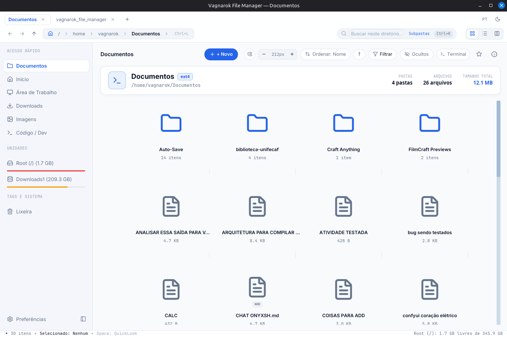

<div align="center">
  

  <h1>Vagnarok File Manager</h1>

  <p>
    <strong>Gerenciador de arquivos desktop nativo de alta performance para Linux e Windows</strong><br />
    Escrito 100% em Rust com <code>iced</code> 0.14 + <code>wgpu</code> — sem WebView, Electron, Tauri ou bindings C/C++.
  </p>

  <p>
    <a href="CHANGELOG.md"></a>
    <a href="LICENSE"></a>
    
    
  </p>

  <p>
    
  </p>
</div>

---

## Visão Geral

O **Vagnarok File Manager** (`dev.vagnarok.FileManager`) combina interface reativa acelerada por GPU (`wgpu` via Vulkan/DirectX 12) e drivers nativos de sistema de arquivos para manter a thread de UI sempre livre, mesmo em diretórios com dezenas de milhares de itens.

* **Estágio atual**: `v0.1.0-alpha.12` (prévia alpha funcional com suporte a Linux e Windows).
* **Requisitos de GPU**: exige placa gráfica com suporte a **Vulkan** (Linux/Windows) ou **DirectX 12** (Windows). **Hardware legado sem suporte a Vulkan/DX12** (ex.: Intel HD Graphics 2000/3000 e GPUs equivalentes da geração D3D10/OpenGL 3.x) **não é suportado no momento**, pois drivers legados e o modo de software (`tiny-skia`) apresentam artefatos visuais em sombras, transparências e overlays.
* **Temas oficiais**: **Obsidian Flow** (Dark) e **Aether Light** (Light), selecionáveis em runtime ou sincronizados automaticamente com o tema do sistema operacional.
* **Arquitetura estrita**: toda leitura de disco, geração de miniaturas, cálculo de hash, busca profunda e telemetria Git roda em workers assíncronos canceláveis (`tokio` + `rayon`).

---

## Principais Funcionalidades

### Navegação, Visualizações e Arquivos Compactados
* **Múltiplas abas e Modo Dividido (`Dual-Pane Split View`, `F3`)**: troca de abas com a roda do mouse, inicialização configurável (Home ou última pasta visitada), histórico voltar/avançar, breadcrumbs interativos, edição direta de caminho (`Ctrl+L`), dois painéis independentes com fechamento de qualquer painel e drag & drop interno entre painéis.
* **2 modos de visualização virtualizados** (renderizam apenas a janela visível do scroll):
  * **Grid** (alinhado da esquerda para direita ou centralizado, agrupado por pastas/arquivos ou unificado, com zoom por `Ctrl + Scroll` ou `Ctrl + +` / `-` / `0`).
  * **Tabela de Detalhes** (ordenação por coluna) com seleção em caixa (*marquee*) ao clicar e arrastar no espaço vazio.
* **Ícones híbridos opcionais**: alternância rápida na barra do canvas entre os ícones vetoriais padrão (`lucide-icons`) e os ícones instalados no sistema hospedeiro (tema Freedesktop + `.desktop` no Linux/Flatpak ou Shell nativo por arquivo `.lnk`/`.exe`/`.ico`/`.url` no Windows), com emblema de seta em symlinks e atalhos e ação **"Abrir local do destino"**.
* **Arquivos compactados e imagens de disco**: navegação transparente em `.zip`/`.tar`/`.tar.gz`/`.7z`/`.rar`, arrastar/copiar itens de dentro de compactados abertos para outro painel, extração com suporte nativo a senha (`.zip` AES/ZipCrypto, `.7z` AES-256 e `.rar`), compactação em segundo plano e montagem de `.iso`/`.img` em nova aba.
* **Arquivos Recentes (`recent://`), Lixeira e Favoritos**: acesso rápido com opção de privacidade em Preferências, drag-and-drop, restauração/esvaziamento de lixeira e gerenciamento persistente de favoritos em TOML.
* **Processos externos desacoplados**: aplicativos abertos pelo gerenciador (players, editores, terminais) rodam em sessões/grupos independentes (`setsid` no Linux e `CREATE_NEW_PROCESS_GROUP` no Windows) e permanecem abertos ao encerrar o app.

### Performance Nativa (Linux & Windows)
* **Linux (`rustix`)**: listagem direta via `getdents64`, metadados estendidos (`statx`), espaço em disco (`statvfs`), montagem via `/proc/mounts`, cópia rápida com `copy_file_range` / `FICLONE` (reflinks em Btrfs/XFS) e abertura de terminal integrada (inclusive com `flatpak-spawn --host` dentro de Flatpak).
* **Windows (`windows` crate)**: enumeração com `FindFirstFileExW`, cópia com progresso via `CopyFileExW`, shell integration com `ShellExecuteExW`, manifesto `longPathAware` + DPI `PerMonitorV2`, efeitos Mica/Acrylic (`window-vibrancy`) e abertura de arquivos com compartilhamento permissivo (`FILE_SHARE_READ | FILE_SHARE_WRITE | FILE_SHARE_DELETE`).
* **`CopyEngine` assíncrono**: copiar, mover, excluir e enviar para lixeira (`trash`) com progresso em bytes, auto-renomeação em conflitos e cancelamento seguro.
* **Alocador `mimalloc`** configurado como alocador global.

### Busca, Telemetria, Previews e Propriedades
* **Monitoramento em tempo real** com `notify` + `notify-debouncer-mini`.
* **Busca instantânea, avançada e `"Pesquisar contendo..."`**:
  * **Filtro rápido na aba (`Ctrl+K`)** com tokens instantâneos em memória (`ext:rs`, `>5KB`, `hoje`, `7d`, `type:image`, `regex:...`) e abertura direta do item selecionado com `↓` + `Enter`.
  * **Busca Avançada & `"Pesquisar contendo..."` (`Ctrl+Shift+F`)**: busca paralela com `rayon` sem indexação prévia, suporte a Regex, filtros por tamanho/data/tipo (magic bytes), trechos por linha (`L<n>`), anel de progresso animado e botão **Minimizar** com pill no rodapé.
* **Command Palette (`Ctrl+Shift+P`) & Quick Jump (`Ctrl+P`)**: acione qualquer ação do app pelo teclado sem menus (`Ctrl+Shift+P`) ou salte instantaneamente para qualquer pasta (`Ctrl+P`).
* **Analisador de Espaço em Disco & Buscador de Duplicados**: mapa proporcional (*Treemap*) clicável, gráficos de barras com *drill-down*, filtros por tamanho e limpeza segura (Lixeira com `Ctrl+Z` ou permanente), além de detector de duplicados MD5 em 4 níveis.
* **Telemetria em background (`fm-telemetry`)**: branch e status Git com `gix` (*gitoxide*), tipo real via *magic bytes* (`infer`), tamanho recursivo de pastas, cache persistente em `redb` e cálculo `SHA-256` sob demanda.
* **QuickLook (`Space`) e Thumbnails (`fm-preview`)**: preview rápido com syntax highlighting (`syntect`), imagens e vetor SVG (`resvg`), redimensionamento SIMD (`fast_image_resize`) e cache LRU + disco (`redb`).
* **Inspetor lateral e janelas flutuantes de Propriedades (não-bloqueantes e simultâneas)**: múltiplas janelas de Propriedades podem ser abertas lado a lado com fundo interativo, incluindo **editor nativo de permissões NTFS (ACL Win32)** no Windows e **editor POSIX modernizado** no Linux (proprietário/grupo, presets, octal ao vivo, bits especiais e aplicação recursiva), além do verificador de atualizações estáveis e menu **Sobre**.

### Internacionalização (`Project Fluent`)
* Catálogos embutidos no binário (zero I/O em runtime) para **6 idiomas**, com pluralização CLDR e seleção via dropdown em **Preferências** (ou indicador rápido no topo):
  * `pt-BR` — Português (BR)
  * `en-US` — English (US)
  * `es-ES` — Español
  * `fr-FR` — Français
  * `de-DE` — Deutsch
  * `it-IT` — Italiano
* Detecção automática do idioma do sistema operacional via `sys-locale` com opção **Sistema (Auto)**.

---

## Atalhos de Teclado

| Atalho | Ação |
| :--- | :--- |
| `Ctrl+T` / `Ctrl+W` / `Ctrl+Tab` | Nova aba / Fechar aba / Alternar aba (`+Shift` volta) |
| `Ctrl+Shift+T` | Abrir terminal no diretório atual |
| `Ctrl+L` | Editar caminho na barra de endereço |
| `Ctrl+P` / `Ctrl+Shift+P` | Quick Jump (ir para pasta) / Command Palette (qualquer ação) |
| `Ctrl+K` / `Ctrl+Shift+F` | Focar busca rápida / Abrir busca avançada e `"Pesquisar contendo..."` |
| `Space` | Abrir ou fechar QuickLook |
| `Alt+←` / `Alt+→` / `Alt+↑` / `Backspace` | Voltar / Avançar / Diretório pai |
| `Setas` / `Enter` | Navegar na grade ou lista / Abrir item focado |
| `Ctrl+A` / `Ctrl+C` / `Ctrl+X` / `Ctrl+V` | Selecionar tudo / Copiar / Recortar / Colar |
| `Ctrl+Shift+N` / `F2` / `Delete` | Nova pasta / Renomear / Lixeira (`Shift+Delete` exclui permanente) |
| `Ctrl+B` / `Alt+I` / `Ctrl+H` | Alternar barra lateral / Inspetor / Arquivos ocultos |
| `Ctrl++` / `Ctrl+-` / `Ctrl+0` / `Ctrl+Scroll` | Aumentar / Diminuir / Resetar zoom do Grid |
| `PageUp` / `PageDown` | Rolagem rápida da lista ou grade |
| `F3` | Alternar modo de tela dividida (*Dual-Pane Split View*) |
| `F5` ou `Ctrl+R` / `Esc` | Atualizar aba / Fechar menu, Propriedades no topo, QuickLook ou limpar filtro |
| `Ctrl+Q` | Fechar janela de propriedades/modal ou encerrar o aplicativo |

---

## Arquitetura do Workspace

O repositório é organizado em 7 crates com fronteiras rígidas de dependência (detalhes em [ARCHITECTURE.md](ARCHITECTURE.md)):

```text
vagnarok_file_manager/
├── assets/
│   ├── fonts/               # Inter e JetBrains Mono embutidas
│   ├── icons/               # Ícone vetorial SVG, PNGs (128/256/512) e .ico
│   └── screenshots/         # Capturas de tela para documentação (screenhome.png)
├── crates/
│   ├── fm-core/             # Domínio puro, traits VfsProvider, estado, eventos e i18n (.ftl)
│   ├── fm-fs/               # LocalFs (Linux rustix / Windows Win32), ArchiveVfs, CopyEngine, config TOML
│   ├── fm-index/            # Watchers notify e busca fuzzy/profunda (nucleo-matcher + ignore)
│   ├── fm-telemetry/        # Workers canceláveis: Git (gix), SHA-256, MIME (infer), cache redb
│   ├── fm-preview/          # Thumbnails SIMD, SVG (resvg), cache redb e QuickLook (syntect)
│   ├── fm-theme/            # Paletas ObsidianFlow / AetherLight e estilos Iced
│   └── fm-app/              # Binário vagnarok-file-manager: shell Iced, viewports e janelas
├── packaging/
│   ├── flatpak/             # Manifesto Flatpak (dev.vagnarok.FileManager.yml)
│   ├── linux/               # Arquivo .desktop e metainfo AppStream
│   └── windows/             # Script do instalador Inno Setup 6 (vagnarok.iss)
├── scripts/
│   └── cut-release.sh       # Helper para bump SemVer, checagem, commit e tag anotada
└── specs/                   # Spec Kit de engenharia (00 a 05)
```

---

## Como Compilar e Executar

### Pré-requisitos
* **Rust**: `1.88+` (edition `2024`).
* **Linux (Debian/Ubuntu)** — cabeçalhos de GUI/Vulkan/Wayland/X11:

```bash
sudo apt-get update && sudo apt-get install -y \
  pkg-config libxkbcommon-dev libxkbcommon-x11-dev libwayland-dev \
  libx11-dev libxcursor-dev libxrandr-dev libxi-dev \
  libvulkan-dev libgl1-mesa-dev libfontconfig1-dev libfreetype6-dev libdbus-1-dev
```

* **Windows**: Rust toolchain MSVC (`x86_64-pc-windows-msvc`).

### Comandos principais

```bash
# Executar em modo desenvolvimento
cargo run -p fm-app

# Compilar binário otimizado de release (gera target/release/vagnarok-file-manager)
cargo build --release --locked -p fm-app

# Executar checagens e suíte de testes do workspace
cargo fmt --all -- --check
cargo clippy --workspace --all-targets -- -D warnings
cargo test --workspace
```

---

## Empacotamento e Releases CI/CD

O projeto possui workflows em [`.github/workflows/ci.yml`](.github/workflows/ci.yml) e [`.github/workflows/release.yml`](.github/workflows/release.yml) para distribuição multiplataforma:

* **Linux `.deb`** (`ubuntu-22.04` com `cargo-deb` a partir de `[package.metadata.deb]` em [crates/fm-app/Cargo.toml](crates/fm-app/Cargo.toml)).
* **Linux Flatpak** (`ubuntu-24.04`, runtime `org.freedesktop.Platform//24.08`, build offline vendored com [dev.vagnarok.FileManager.yml](packaging/flatpak/dev.vagnarok.FileManager.yml)).
* **Windows Installer & Portable** (`windows-latest`, instalador via **Inno Setup 6** em [vagnarok.iss](packaging/windows/vagnarok.iss) + arquivo `.zip` portátil).
* **GitHub Releases**: disparado em tags `v*.*.*` (ou via `workflow_dispatch`), publicando todos os pacotes acompanhados de `SHA256SUMS.txt`.

Para preparar uma nova tag localmente após atualizar o [CHANGELOG.md](CHANGELOG.md) e o [README.md](README.md):

```bash
./scripts/cut-release.sh 0.1.0-alpha.12
git push origin main v0.1.0-alpha.12
```

---

## Documentação e Especificação

* [ARCHITECTURE.md](ARCHITECTURE.md) — Visão geral, grafo de crates e decisões técnicas Linux/Windows.
* [AGENTS.md](AGENTS.md) — Regras invioláveis de engenharia e fluxo Git obrigatório.
* [specs/00-spec-index.md](specs/00-spec-index.md) — Índice completo do Spec Kit (`00` a `05`).
* [CHANGELOG.md](CHANGELOG.md) — Histórico cronológico de marcos e mudanças.

---

## Licença

Distribuído sob a licença **GNU General Public License v3.0 ou posterior (`GPL-3.0-or-later`)**. Consulte o arquivo [LICENSE](LICENSE) para o texto integral.
